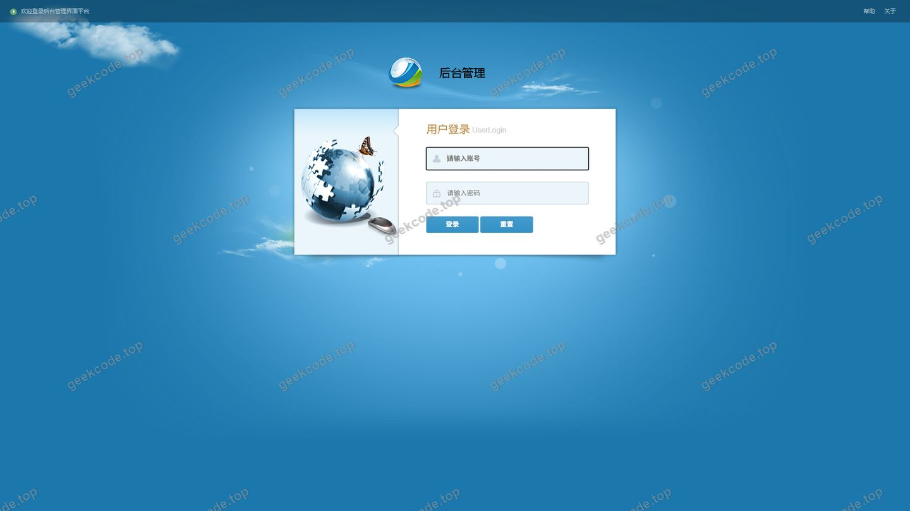
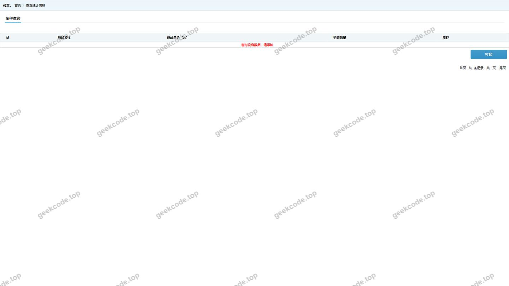
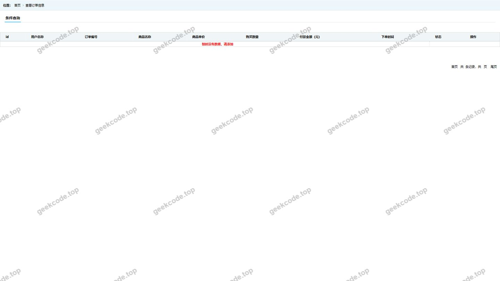
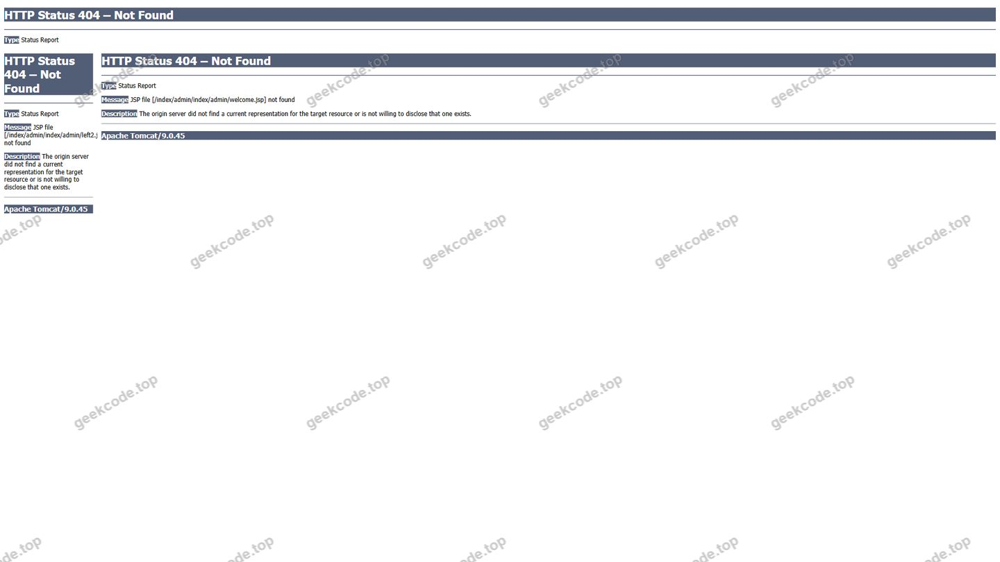
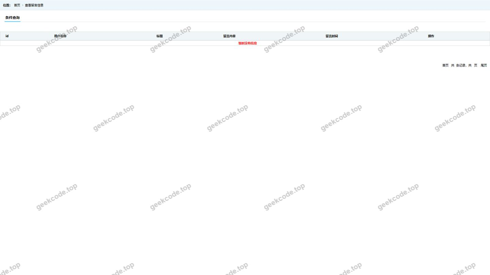
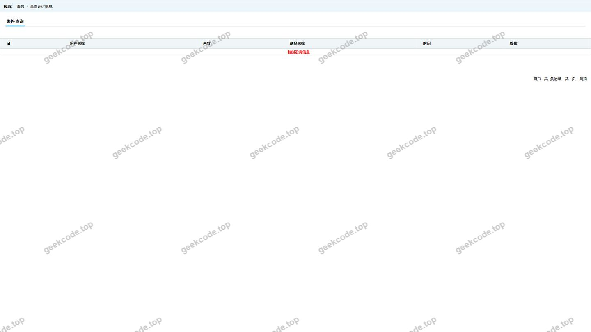
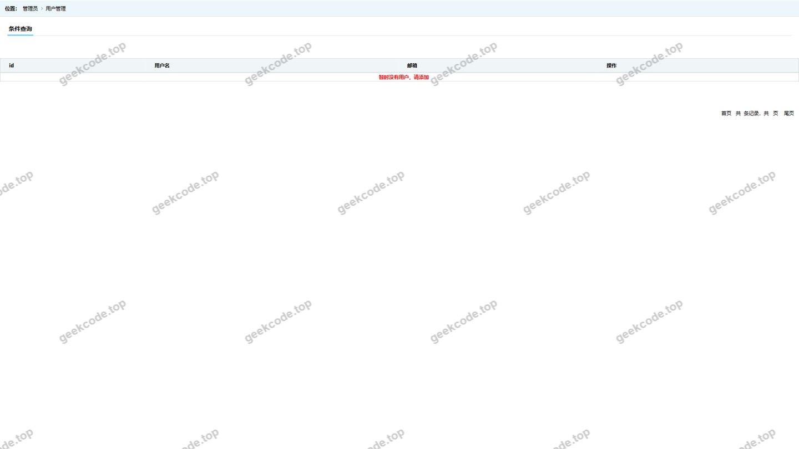
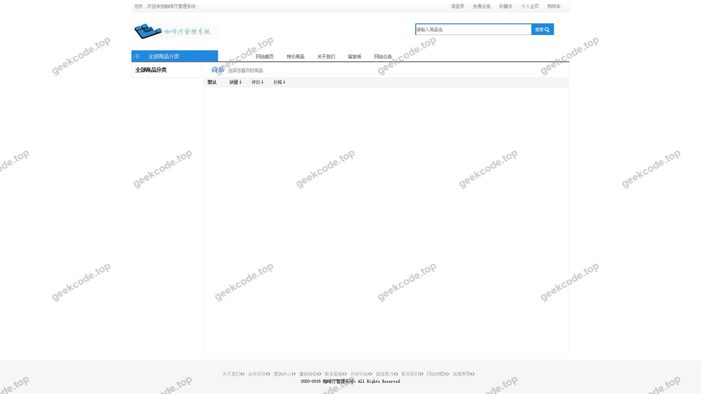

# SSM 咖啡厅管理系统

> 🎓 **计算机毕业设计 · SSM 咖啡厅管理系统**
>
> 本仓库只放**项目介绍 + 运行截图**（截图是站点带水印的原图，存在仓库 `images/` 里）。
>
> 👉 **完整可运行源码 / 数据库脚本 / 部署文档：[点我获取](https://geekcode.top/archives/SSM-%E5%92%96%E5%95%A1%E5%8E%85%E7%AE%A1%E7%90%86%E7%B3%BB%E7%BB%9F?utm_source=github)**
>
> 💬 咨询微信：**ir9372**　|　🌐 更多项目：[极客代码 geekcode.top](https://geekcode.top/?utm_source=github)
>
> 📌 项目详情页：<https://geekcode.top/archives/SSM-%E5%92%96%E5%95%A1%E5%8E%85%E7%AE%A1%E7%90%86%E7%B3%BB%E7%BB%9F?utm_source=github>

<table><td width="230" align="center"> <b>扫码加微信 ir9372</b></td><td valign="middle">📦 源码 = 项目介绍 + 全部运行截图 + 数据库 + 部署文档 👉 点上方任意截图，直接跳到 <b>极客代码 geekcode.top</b> 详情页</td></table>

---

<h1>SSM 咖啡厅管理系统</h1>
<h2>项目概述</h2>

本项目为 SSM 咖啡厅管理系统，旨在通过信息化手段优化咖啡厅的日常运营与管理流程。系统采用经典的 SSM（Spring + Spring MVC + MyBatis）框架结合 JSP 技术构建，主要面向咖啡厅管理人员及内部工作人员使用。核心功能涵盖用户管理、订单处理、数据统计分析以及收藏管理等模块，实现了从基础数据维护到业务报表生成的闭环管理。该系统适用于中小型实体咖啡厅或连锁门店的内部管理场景，能够有效降低人工统计成本，提升数据查询效率，确保业务数据的准确性与实时性。

<h2>技术架构</h2>

本系统基于 Java EE 标准体系进行开发，采用分层架构设计以确保系统的可维护性与扩展性。

<ol>
<li><strong>后端架构</strong>：</li>
</ol>
<ul>
<li><strong>表现层 (Controller)</strong>：使用 Spring MVC 处理 HTTP 请求，负责页面跳转逻辑及数据接收，通过 <code>@RequestMapping</code> 等注解映射 URL 至具体方法。</li>
<li><strong>业务层 (Service)</strong>：由 Spring 容器管理 Bean 的生命周期，利用事务管理器 (<code>@Transactional</code>) 保证业务操作的原子性，处理核心商业逻辑。</li>
<li><strong>持久层 (DAO/Mapper)</strong>：集成 MyBatis 框架，通过 XML 配置文件或注解方式定义 SQL 语句，实现对象与关系型数据库之间的映射，简化 JDBC 操作。</li>
</ul>
<ol start="2">
<li><strong>前端架构</strong>：</li>
</ol>
<ul>
<li>采用 JSP (Java Server Pages) 作为视图层技术，直接在服务器端渲染 HTML 页面。</li>
<li>通过 JSTL (JSP Standard Tag Library) 标签库在页面中展示后端传递的数据模型。</li>
<li>界面交互主要依赖表单提交与链接跳转，未引入复杂的前端单页应用框架。</li>
</ul>
<ol start="3">
<li><strong>数据库设计要点</strong>：</li>
</ol>
<ul>
<li>选用 MySQL 作为底层数据存储引擎。</li>
<li>根据截图功能推断，数据库至少包含以下核心表结构：用户信息表（存储登录凭证及基本信息）、订单表（记录交易详情）、商品/菜单表（咖啡厅售卖物品）、收藏表（记录用户偏好）以及用于统计分析的聚合数据表。</li>
<li>各表之间通过主外键关联，确保数据一致性。</li>
</ul>
<h2>功能模块</h2>

根据提供的截图列表及项目性质，系统主要划分为以下功能模块。由于项目无独立的前台导航与后台路由配置，所有功能均集成于统一的 Web 访问入口中。

<h3>1. 身份认证模块</h3>
<ul>
<li><strong>页面-登录</strong>：提供用户身份验证功能，支持管理员或授权用户输入账号密码进入系统首页。这是系统的安全入口，确保只有合法用户才能访问敏感数据。</li>
</ul>
<h3>2. 系统主页与概览</h3>
<ul>
<li><strong>页面-系统首页</strong>：作为登录后的默认落地页，展示系统的基本状态或快捷入口。通常包含关键指标的简要预览，方便用户快速了解当前系统运行概况。</li>
</ul>
<h3>3. 数据统计与分析模块</h3>

该模块是系统的核心价值所在，通过多维度数据查询辅助管理决策：

<ul>
<li><strong>页面-selCount</strong>：数量统计功能。可能涉及对特定时间段内的订单量、销售额或库存数量的汇总查询，以图表或表格形式呈现总量指标。</li>
<li><strong>页面-selDd</strong>：订单查询功能 (&quot;Dd&quot; 推测为 &quot;Ding Dan&quot; 即订单)。支持按条件筛选历史订单记录，查看订单状态、金额及关联商品信息。</li>
<li><strong>页面-selLy</strong>：来源或类别分析 (&quot;Ly&quot; 推测为 &quot;Lai Yuan&quot; 来源或 &quot;Lei Bie&quot; 类别)。用于分析客户来源渠道或商品分类的销售占比，帮助优化营销策略。</li>
<li><strong>页面-selPl</strong>：评论或批量数据处理 (&quot;Pl&quot; 推测为 &quot;Ping Lun&quot; 评论或 &quot;Pi Liang&quot; 批量)。若为评论，则展示用户对咖啡厅服务或产品的评价；若为批量，则涉及数据的批量导入导出或操作。鉴于“收藏”存在，此处更倾向于业务相关的批量查询或评价管理。</li>
</ul>
<h3>4. 用户管理模块</h3>
<ul>
<li><strong>页面-sel用户</strong>：用户信息查询与管理。支持查看注册用户的详细信息，包括联系方式、注册时间及账户状态，便于管理员进行会员维护。</li>
</ul>
<h3>5. 互动与收藏模块</h3>
<ul>
<li><strong>页面-collect</strong>：收藏管理功能。记录用户对特定商品、饮品或服务的收藏行为，支持查看、添加或删除收藏项，体现个性化服务特征。</li>
</ul>
<h2>用户角色与权限</h2>

基于 SSM 咖啡厅管理系统的典型应用场景及现有功能截图，系统主要涉及两类用户角色。由于未提供详细的 RBAC（基于角色的访问控制）代码上下文，以下权限划分基于通用管理逻辑推导：

<h3>1. 系统管理员 (Admin)</h3>

拥有最高权限，负责系统的整体运维与数据管理。

<ul>
<li><strong>可访问功能模块</strong>：</li>
<li><strong>登录</strong>：使用管理员账号进入系统。</li>
<li><strong>系统首页</strong>：查看全局概览。</li>
<li><strong>selCount</strong>：查看所有维度的统计数据，不受数据隔离限制。</li>
<li><strong>selDd</strong>：查询所有用户的订单记录，进行订单审核或退款操作。</li>
<li><strong>selLy</strong>：分析全平台的流量来源或分类销售情况。</li>
<li><strong>selPl</strong>：管理所有评论数据或执行批量数据处理任务。</li>
<li><strong>sel用户</strong>：查看、编辑、禁用或删除任何用户账户。</li>
<li><strong>collect</strong>：查看系统内所有的收藏数据记录（用于数据分析）。</li>
</ul>
<h3>2. 普通用户/店员 (User/Staff)</h3>

权限受限，仅能访问与其职责相关的数据或个人信息。

<ul>
<li><strong>可访问功能模块</strong>：</li>
<li><strong>登录</strong>：使用个人账号进入系统。</li>
<li><strong>系统首页</strong>：查看个人工作台或简化的数据看板。</li>
<li><strong>selDd</strong>：仅能查询自己经手或与自己相关的订单信息。</li>
<li><strong>collect</strong>：管理个人的收藏列表，添加或移除喜欢的商品。</li>
<li><strong>sel用户</strong>：仅能查看和修改自己的个人信息。</li>
<li><strong>注意</strong>：普通用户通常无法访问 <code>selCount</code>、<code>selLy</code> 等全局统计模块，也无法查看其他用户的信息，除非具备特定的店员权限且系统设计允许。</li>
</ul>

<em>(注：由于项目明确标注“是否有前台: 否”、“是否有后台: 否”，暗示这可能是一个内部使用的单一接口管理系统，上述角色权限需根据实际部署时的账号类型进行区分。)</em>

<h2>项目特色与创新点</h2>
<ol>
<li><strong>轻量级高效架构</strong>：采用成熟的 SSM 组合，摒弃了复杂的微服务治理开销，对于咖啡厅这类业务逻辑相对固定的中小规模应用，具有部署快、资源占用低、运行稳定的优势。</li>
<li><strong>多维数据可视化洞察</strong>：通过 <code>selCount</code>、<code>selLy</code>、<code>selDd</code> 等专用查询页面，将分散的业务数据转化为直观的统计结果。这种针对特定业务场景（如销量、来源、订单）的定制化查询接口，比通用的 CRUD 页面更能直接服务于经营决策。</li>
<li><strong>一体化管理体验</strong>：系统将用户管理、订单处理、收藏互动整合在同一套 JSP 界面下，减少了多系统切换的认知负担，提升了操作人员的工作效率。</li>
<li><strong>经典技术栈稳定性</strong>：基于 JSP 和服务端渲染的技术路线，确保了在弱网环境或老旧浏览器下的兼容性，适合传统实体行业的 IT 基础设施现状。</li>
</ol>
<h2>部署环境</h2>

为确保 SSM 咖啡厅管理系统正常运行，需要搭建以下软件环境：

<ol>
<li><strong>操作系统</strong>：Windows 7/10/11, Linux (CentOS/Ubuntu), 或 macOS。</li>
<li><strong>Java 运行环境</strong>：</li>
</ol>
<ul>
<li>JDK 版本：建议 JDK 1.8 或更高版本（需兼容 Spring 框架版本）。</li>
</ul>
<ol start="3">
<li><strong>Web 应用服务器</strong>：</li>
</ol>
<ul>
<li>Tomcat 版本：Apache Tomcat 8.5 或 9.x（需支持 Servlet 3.1+ 规范）。</li>
</ul>
<ol start="4">
<li><strong>数据库管理系统</strong>：</li>
</ol>
<ul>
<li>MySQL 版本：MySQL 5.7 或 MySQL 8.0。</li>
<li>需安装相应的 JDBC 驱动包。</li>
</ul>
<ol start="5">
<li><strong>开发工具</strong>（可选，用于二次开发）：</li>
</ol>
<ul>
<li>IDE：IntelliJ IDEA 或 Eclipse。</li>
<li>构建工具：Maven 3.6+（用于依赖管理和项目构建）。</li>
</ul>
<ol start="6">
<li><strong>浏览器</strong>：Chrome, Firefox, Edge 或 IE 11 及以上版本（用于访问 JSP 页面）。</li>
</ol>
<h2>五、技术特性</h2>
<ul>
<li>服务端模板渲染（JSP）</li>
</ul>
<h2>六、功能模块截图</h2>
<h3>后台管理端</h3>
<h4>页面-登录</h4>

<h4>页面-selCount</h4>

<h4>页面-selDd</h4>

<h4>页面-系统首页</h4>

<h4>页面-selLy</h4>

<h4>页面-selPl</h4>

<h4>页面-sel用户</h4>

<h4>页面-系统首页</h4>

<h4>页面-collect</h4>

---

## 获取完整源码

| 项目 | 说明 |
| --- | --- |
| 项目名 | SSM 咖啡厅管理系统 |
| 运行截图 | 本文 9 张（站点带水印原图，仓库 `images/` 目录） |
| 完整源码 | [https://geekcode.top/archives/SSM-%E5%92%96%E5%95%A1%E5%8E%85%E7%AE%A1%E7%90%86%E7%B3%BB%E7%BB%9F?utm_source=github](https://geekcode.top/archives/SSM-%E5%92%96%E5%95%A1%E5%8E%85%E7%AE%A1%E7%90%86%E7%B3%BB%E7%BB%9F?utm_source=github) |
| 咨询微信 | **ir9372**（备注：jingpin-yuanma） |
| 更多项目 | [极客代码 geekcode.top](https://geekcode.top/?utm_source=github) |

> 需要源码、部署、改配置、跑不起来等问题，加微信 ir9372 沟通，说明项目名即可。
